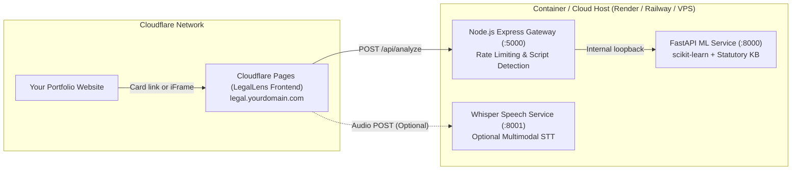

# LegalLens Deployment & Portfolio Integration Guide

This guide explains how to deploy **LegalLens (Hybrid AI-Powered Legal Awareness System)** and integrate it seamlessly with your existing portfolio website on **Cloudflare**.

---

## Architecture Overview



### Why This Split?
- **Frontend (Cloudflare Pages)**: 100% free, unlimited bandwidth, global edge CDN, instant SSL, and lives on your existing Cloudflare account.
- **Backend (Render / Railway / Fly.io / VPS)**: Hosts the Python ML runtime (FastAPI + scikit-learn) and Node.js gateway bundled together in a single production Docker container.

---

## Step 1: Deploy Backend & ML Service

We provide a production-ready `Dockerfile` at the repository root that bundles both the **Express Gateway** and **FastAPI ML Service** into a single container.

### Option A: Render (Free Web Service)
1. Push your code to GitHub.
2. Sign up / Log in to [Render.com](https://render.com).
3. Click **New +** → **Web Service**.
4. Connect your GitHub repository: `hybrid-ai-powered-legal-awareness-system`.
5. Configure:
   - **Name**: `legallens-api`
   - **Environment**: `Docker`
   - **Dockerfile Path**: `./Dockerfile`
   - **Instance Type**: `Free`
6. Click **Create Web Service**.
7. Once deployed, test your API health check:
   ```bash
   curl https://<your-render-subdomain>.onrender.com/api/health
   ```
   You should receive:
   ```json
   {"success":true,"gateway":"ok","ml_service":{"reachable":true,"status":"ok","classifier_mode":"trained",...}}
   ```
8. Save this URL: `https://<your-render-subdomain>.onrender.com/api` (this will be your `VITE_API_BASE`).

> [!TIP]
> **Handling Free Tier Sleep**: Render free instances spin down after 15 minutes of inactivity. You can use a free uptime monitor (like [UptimeRobot](https://uptimerobot.com) or [cron-job.org](https://cron-job.org)) to ping `https://<your-app>.onrender.com/api/health` every 10 minutes to keep it warm.

### Option B: Railway / Fly.io / Self-Hosted VPS
- **Railway**: Click **New Project** → **Deploy from GitHub Repo** → Railway automatically detects `Dockerfile`. Set the port to `$PORT`.
- **VPS with Docker Compose**: Clone repo on your VPS and run `docker compose up -d`.

---

## Step 2: Deploy Frontend on Cloudflare Pages

Since your portfolio is already on Cloudflare, deploying the frontend on **Cloudflare Pages** takes less than 2 minutes and costs $0.

1. Go to the [Cloudflare Dashboard](https://dash.cloudflare.com/) → **Workers & Pages** → **Create application** → **Pages** → **Connect to Git**.
2. Select your repository: `hybrid-ai-powered-legal-awareness-system`.
3. Configure build settings:
   - **Project Name**: `legallens` (or your choice)
   - **Production Branch**: `main` (or your active branch)
   - **Framework Preset**: `Vite`
   - **Root directory**: `frontend`
   - **Build command**: `npm run build`
   - **Build output directory**: `dist`
4. Under **Environment variables**, add:
   | Variable | Value | Description |
   |---|---|---|
   | `VITE_API_BASE` | `https://<your-backend-url>/api` | Your deployed backend URL from Step 1 |
   | `NODE_VERSION` | `20` | Recommended Node runtime |
5. Click **Save and Deploy**.

> [!NOTE]
> Client-side routing is pre-configured! The `frontend/public/_redirects` file automatically ensures React Router routes (e.g. `/analyze`, `/how-it-works`) do not 404 when refreshed.

---

## Step 3: Link to Your Custom Domain on Cloudflare

If your portfolio uses a custom domain on Cloudflare (e.g. `yourname.dev`):

1. In Cloudflare Dashboard, navigate to your new **Pages** project (`legallens`).
2. Go to **Custom domains** tab → click **Set up a custom domain**.
3. Enter your desired subdomain:
   ```text
   legal.yourname.dev
   # or
   legallens.yourname.dev
   ```
4. Cloudflare automatically configures the DNS CNAME record and provisions a free SSL certificate.

---

## Step 4: Add to Your Portfolio Website

Choose whichever integration style fits your portfolio best:

### Approach A: Featured Project Showcase Card (Recommended)

Add a project card to your portfolio's "Projects" or "Work" section:

#### Preview Snippet (React / Tailwind CSS):
```tsx
import { ExternalLink, Github, Scale, Brain, Shield, Mic } from "lucide-react";

export function LegalLensProjectCard() {
  return (
    <div className="group relative rounded-2xl border border-neutral-800 bg-neutral-900/60 p-6 backdrop-blur-sm transition-all hover:border-cyan-500/50 hover:shadow-lg hover:shadow-cyan-500/10">
      <div className="flex items-center justify-between pb-4">
        <div className="flex items-center gap-2.5">
          <div className="rounded-lg bg-cyan-500/10 p-2 text-cyan-400">
            <Scale className="h-6 w-6" />
          </div>
          <div>
            <h3 className="text-xl font-bold text-white group-hover:text-cyan-400 transition-colors">
              LegalLens
            </h3>
            <p className="text-xs text-neutral-400">Multilingual Legal Awareness System</p>
          </div>
        </div>
        <span className="rounded-full bg-cyan-500/10 px-3 py-1 text-xs font-medium text-cyan-300 border border-cyan-500/20">
          AI / Full-Stack
        </span>
      </div>

      <p className="text-sm leading-relaxed text-neutral-300 mb-4">
        AI-assisted citizen legal empowerment engine. Classifies citizen grievances across 5 statutory domains,
        matches specific legal issues using TF-IDF cosine similarity, maps penal provisions & authorities,
        and supports voice input in English, Hindi, and Kannada.
      </p>

      {/* Tech Badges */}
      <div className="flex flex-wrap gap-1.5 mb-6">
        {["FastAPI", "Express.js", "React / Vite", "scikit-learn", "faster-whisper", "Cloudflare Pages"].map((tech) => (
          <span key={tech} className="rounded-md bg-neutral-800/80 px-2.5 py-1 text-xs text-neutral-300 border border-neutral-700/50 font-mono">
            {tech}
          </span>
        ))}
      </div>

      {/* Action Buttons */}
      <div className="flex items-center gap-3 pt-2 border-t border-neutral-800">
        <a
          href="https://legal.yourname.dev"
          target="_blank"
          rel="noopener noreferrer"
          className="inline-flex items-center gap-2 rounded-lg bg-cyan-500 hover:bg-cyan-400 text-neutral-950 px-4 py-2 text-sm font-semibold transition-all shadow-sm"
        >
          <span>Live Demo</span>
          <ExternalLink className="h-4 w-4" />
        </a>
        <a
          href="https://github.com/yogeshs1717/hybrid-ai-powered-legal-awareness-system"
          target="_blank"
          rel="noopener noreferrer"
          className="inline-flex items-center gap-2 rounded-lg border border-neutral-700 hover:bg-neutral-800 text-neutral-200 px-4 py-2 text-sm font-medium transition-all"
        >
          <Github className="h-4 w-4" />
          <span>Source Code</span>
        </a>
      </div>
    </div>
  );
}
```

---

### Approach B: In-Page Interactive Embed (iFrame)

If you want visitors to interact with LegalLens directly on your portfolio website without navigating away:

```html
<div style="width: 100%; border-radius: 12px; overflow: hidden; border: 1px solid #333; box-shadow: 0 10px 30px rgba(0,0,0,0.3);">
  <div style="background: #111; padding: 10px 16px; display: flex; align-items: center; justify-content: space-between; border-bottom: 1px solid #222;">
    <span style="color: #aaa; font-family: monospace; font-size: 13px;">https://legal.yourname.dev</span>
    <a href="https://legal.yourname.dev" target="_blank" style="color: #00c5ff; font-size: 12px; text-decoration: none;">Open in New Tab ↗</a>
  </div>
  <iframe
    src="https://legal.yourname.dev"
    style="width: 100%; height: 750px; border: none; background: #090a0f;"
    allow="microphone"
    title="LegalLens Interactive Demo"
    loading="lazy">
  </iframe>
</div>
```

> [!IMPORTANT]
> The `allow="microphone"` attribute is required on the `<iframe>` tag if you want users to test voice input in English, Hindi, or Kannada directly from inside your portfolio!

---

### Approach C: Cloudflare Workers Reverse Proxy (Subpath `yourname.dev/legal`)

If you want the app accessible at `https://yourname.dev/legal` instead of a separate subdomain:

Add a route in your Cloudflare Worker:
```javascript
export default {
  async fetch(request, env) {
    const url = new URL(request.url);

    // Forward /legal/* to Cloudflare Pages deployment
    if (url.pathname.startsWith("/legal")) {
      const targetUrl = new URL(request.url);
      targetUrl.hostname = "legallens.pages.dev";
      targetUrl.pathname = url.pathname.replace(/^\/legal/, "") || "/";
      return fetch(new Request(targetUrl, request));
    }

    // Default portfolio handling
    return env.ASSETS.fetch(request);
  }
};
```

---

## Step 5: What About the Speech Service (Whisper)?

- **Typed Scenario Analysis**: Works out-of-the-box in English, Hindi, and Kannada. The backend automatically detects Devanagari / Kannada script and translates text seamlessly.
- **Voice Input (faster-whisper)**:
  - If the speech service is not deployed, the frontend gracefully alerts the user: *"Speech service not reachable. Type scenario directly."*
  - To host the speech service in production, you can either:
    1. Run it on a VPS with `speech-service/Dockerfile`.
    2. Deploy it as a Hugging Face Space (Docker with 16GB free RAM).
    3. Point `VITE_SPEECH_API_URL` to its public URL.

---

## Verification Checklist

- [ ] Backend deployed and responds at `GET /api/health` with `{"success": true, ...}`
- [ ] Cloudflare Pages deployed with `VITE_API_BASE` pointing to backend `/api`
- [ ] Navigating directly to `https://<your-pages-url>/analyze` and refreshing doesn't 404 (handled by `_redirects`)
- [ ] Subdomain `legal.yourname.dev` active with SSL on Cloudflare
- [ ] Portfolio website has project card or embedded frame linking to live demo and GitHub
